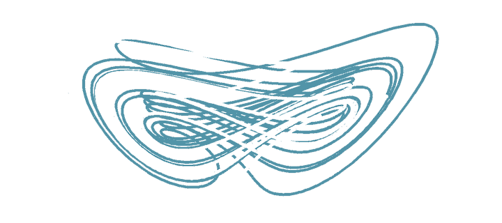
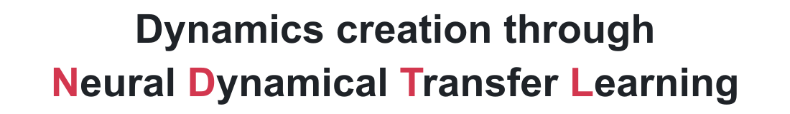
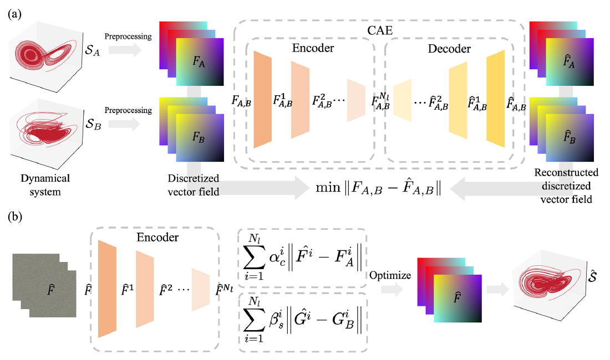

<p align="center">
  <a href="https://967255.github.io/NDTL/">
    <picture>
      <source media="(prefers-reduced-motion: reduce)" srcset="docs/images/ndtl-banner.svg">
      <source media="(prefers-color-scheme: dark)" srcset="docs/images/ndtl-banner-dark.gif">
      
    </picture>
  </a>
</p>

<h1 align="center">
  <picture>
    <source media="(prefers-color-scheme: dark)" srcset="docs/images/ndtl-title-dark.svg">
    
  </picture>
</h1>

<p align="center">
  <strong>Physical Review Research 8, 033337 (2026)</strong>
</p>

<p align="center">
  <a href="https://github.com/967255">He Ma</a><sup>1,2,*</sup> &middot;
  Qiyang Ge<sup>2,*</sup> &middot;
  <a href="https://iics.fudan.edu.cn/f9/11/c33358a784657/page.htm">Yu Meng</a><sup>2</sup> &middot;
  Celso Grebogi<sup>3</sup> &middot;
  <a href="https://faculty.fudan.edu.cn/wlin/zh_CN/more/652043/jsjjgd/index.htm">Wei Lin</a><sup>1,2,4,5,&dagger;</sup>
</p>

<p align="center">
  <sup>*</sup> Equal contribution &nbsp;&nbsp; <sup>&dagger;</sup> Corresponding author
</p>

<p align="center">
  Fudan University &nbsp;&middot;&nbsp; University of Aberdeen &nbsp;&middot;&nbsp; Shanghai Artificial Intelligence Laboratory
</p>

<p align="center">
  <a href="https://967255.github.io/NDTL/"></a>
  <a href="https://doi.org/10.1103/ccgv-hgjb"></a>
  <a href="https://967255.github.io/NDTL/assets/paper/ndtl-prr-2026.pdf"></a>
</p>

<p align="center">
  
  
  <a href="LICENSE"></a>
  <a href="CITATION.cff"></a>
</p>

<p align="center">
  <a href="#quick-start">Quick start</a> &nbsp;&middot;&nbsp;
  <a href="#experiments">Experiments</a> &nbsp;&middot;&nbsp;
  <a href="docs/RUNNING.md">Running guide</a> &nbsp;&middot;&nbsp;
  <a href="#citation-and-contact">Citation and contact</a>
</p>

Neural dynamical transfer learning (NDTL) is a neural network framework for
creating new nonlinear dynamical systems with prescribed dynamics. It fuses
content and style features extracted from parent vector fields. This repository
implements the paper's dynamics creation, NDTL-induced classification, and
multidisciplinary application experiments in a common Python workflow.

> **[Explore the interactive project website &rarr;](https://967255.github.io/NDTL/)**<br>
> View fusion trajectories, the NDTL-induced classification of 52 chaotic systems,
> and applications to ecology, epidemiology, and chaotic image encryption.
> The website runs directly in your browser.

## NDTL framework

<p align="center">
  
</p>

<p align="center">
  <sub>Figure 1 from the <a href="https://doi.org/10.1103/ccgv-hgjb">published article</a>, by He Ma, Qiyang Ge, Yu Meng, Celso Grebogi, and Wei Lin. CC BY 4.0.</sub>
</p>

- **Dynamics creation.** Create new nonlinear dynamical systems by matching
  content and style features of parent vector fields.
- **Feature interpretation and validation.** Examine content and style features
  through a Hamiltonian example, transformation tests, and layerwise perturbations.
- **Dynamics classification.** Construct NDTL-induced dissimilarities from
  Lyapunov spectrum landscapes along content fusion, then apply spectral and
  hierarchical clustering.
- **Multidisciplinary applications.** Demonstrate stable oscillatory coexistence
  in the Hastings-Powell food chain model, interpretable epidemiological models,
  and fused chaotic sources for image encryption.

## Quick start

Use Python 3.9 and install the pinned scientific dependencies:

```bash
git clone https://github.com/967255/NDTL.git
cd NDTL
python -m pip install -r requirements.txt
python -m experiments doctor
python -m experiments check-results
```

Plot the NDTL-induced classification of 52 chaotic systems from recorded results:

```bash
python -m experiments run fig5 --output outputs/classification/fig5
```

Inspect the experiment catalog or run fusion using content features:

```bash
python -m experiments list
python -m experiments show E20
python -m experiments run classic-fuse --output outputs/classic/e01 -- --systems lorenz lv
python -m experiments run hp-generate --output outputs/hp/main
```

Run commands from the repository root and choose a fresh `--output` directory.
The launcher records arguments and exit status in `run.json`.

A CUDA-enabled PyTorch installation can be used for training. CPU execution is
supported with `--device cpu` where available. The optional approximate TwoNN
mode requires `hnswlib`; the default settings use exact nearest neighbors.

## Experiments

| Experiment family | Paper task | Code and guide |
| --- | --- | --- |
| **Dynamical system fusion** | Content and style feature fusion, governing-equation regression, and dynamical signatures | [classic](experiments/classic/README.md) |
| **Dynamics classification** | NDTL-induced dissimilarities, spectral and hierarchical clustering, and visualization for 20- and 52-system benchmarks | [classification](experiments/classification/README.md) |
| **Hastings-Powell food chain model** | Content fusion, projection onto the HP model family, and validation of oscillatory coexistence | [hp](experiments/hp/README.md) |
| **SEIRS epidemiological model** | Fusion of SEIRS content with Lorenz style and sparse governing equations via LASSO regression | [seirs](experiments/seirs/README.md) |
| **Chaotic image encryption** | Fused chaotic sources evaluated in a permutation diffusion image encryption pipeline | [encryption](experiments/encryption/README.md) |
| **Content and style features** | Transformation properties and layerwise perturbation analysis | [perturbation](experiments/perturbation/README.md) |

See the **[complete running guide](docs/RUNNING.md)** for commands and the
**[paper experiment index](docs/EXPERIMENTS.md)** for figure and table mappings.

## Repository guide

```text
NDTL/
├── ndtl/                  Shared CAE, training, vector fields, systems, and metrics
├── experiments/           Six experiment families and the common launcher
├── checkpoints/           Seven selected CAEs for classic systems, HP, and SEIRS
├── docs/                  Running instructions and paper experiment mapping
├── website/               Interactive research website and publishing tools
├── third_party/dysts/     Licensed attractor reference definitions
└── outputs/               Generated runs and figures (ignored by Git)
```

Each experiment family owns its implementation, presets, and recorded small
result tables. The `ndtl/` package contains shared numerical components.

The seven selected CAE checkpoints are included; see
[checkpoint documentation](docs/CHECKPOINTS.md). Small recorded metrics in
`experiments/<family>/results/` support the classification, classical-system, HP,
and encryption plotting jobs. Generated raw fields and per-pair classification
checkpoints are not distributed, and there is no separate data download.
New optimization runs should retain their own configuration; the provided
checkpoints do not imply a full rerun of every paper experiment.

For the interactive website's structure and publishing workflow, see
[website/README.md](website/README.md).

## Citation and contact

If you use NDTL in your research, please cite:

```bibtex
@article{ma2026dynamics,
  title   = {Dynamics creation through neural dynamical transfer learning},
  author  = {Ma, He and Ge, Qiyang and Meng, Yu and Grebogi, Celso and Lin, Wei},
  journal = {Physical Review Research},
  volume  = {8},
  number  = {3},
  pages   = {033337},
  year    = {2026},
  doi     = {10.1103/ccgv-hgjb}
}
```

Machine-readable metadata is available in [CITATION.cff](CITATION.cff).

Code contact: He Ma, [hma23@m.fudan.edu.cn](mailto:hma23@m.fudan.edu.cn).

## License

The code is released under the [MIT License](LICENSE). The paper and its reproduced
framework figure are licensed under [CC BY 4.0](https://creativecommons.org/licenses/by/4.0/).
See [THIRD_PARTY_NOTICES.md](THIRD_PARTY_NOTICES.md) for DYSTS attribution.
